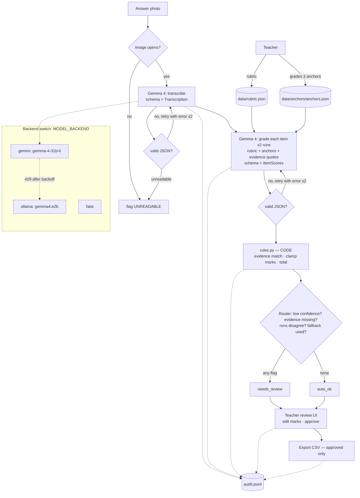

# Architecture

## 1. In plain words
A teacher gives us a **rubric** (what earns marks) and grades **3 anchor scripts** by hand. For each new handwritten answer:

1. **Read**: Gemma 4 looks at the photo and writes out the answer as text (a *transcription*).
2. **Grade**: Gemma 4 scores each rubric item. For every mark it must **quote the exact words** that earned it. The 3 anchors are put in the prompt as examples, so the model learns *this* teacher's strictness.
3. **Check (code, not AI)**: Python checks that each quote really appears in the transcription and that marks are allowed values. Python adds up the total. **The model never does arithmetic.**
4. **Route**: doubtful scripts go to the teacher's review pile. Nothing is released until the teacher approves.
5. **Log**: every step and every teacher edit is written to an audit log.

### Glossary
| Term | Meaning |
|---|---|
| **JSON schema / structured output** | A fixed "shape" for the model's reply (fields and types). We ask Gemma to reply only in that shape. |
| **Pydantic** | A Python library that checks a reply matches the shape. If it doesn't, we send the error back and ask again (max 2 retries). |
| **Few-shot / calibration with anchors** | Putting a few teacher-graded examples in the prompt so the model copies that teacher's marking style. No training involved. |
| **Self-consistency** | Grading the same script twice. If the two totals differ by ≥1 mark, the model is unsure. |
| **Confidence routing** | Deciding whether a script is `auto_ok` or `needs_review`, using several signals (below). |
| **Audit log** | An append-only diary (`audit.jsonl`, one JSON line per event): who did what, when, before/after. |
| **Drift check** *(stretch)* | Every 5 scripts, re-grade an anchor (with that anchor removed from the examples) and warn if it is >1 mark off. |
| **Backend** | Which model answers: `gemini` (hosted Gemma 4 31B), `ollama` (local Gemma 4 E2B), or `fake` (made-up data for building the UI). |

## 2. Pipeline


## 3. Folders
```
app.py               Streamlit UI                      (Person B)
eval/run_eval.py     metrics → eval/results/           (Person B)
copilot/
  schemas.py         data shapes — SHARED CONTRACT     (change only on main)
  config.py          settings from .env — SHARED       (change only on main)
  models.py          generate_json(): gemini/ollama/fake, retry, backoff, fallback (Person A)
  prompts.py         prompt text                       (Person A)
  rules.py           evidence match, clamp, total      (Person A)
  pipeline.py        grade_script() (A) · approve() · export_csv()
  store.py           read/write JSON files in data/
  audit.py           append-only audit log
  fake.py            made-up outputs for MODEL_BACKEND=fake
data/                rubric, anchors, scripts/ (photos), teacher_marks.csv
scripts/smoke_test.py  run after every merge
```

## 4. Data schemas (full definitions in `copilot/schemas.py`)
```jsonc
// Rubric (teacher input)
{"rubric_id": "phys-q1", "question": "...", "items": [
  {"item_id": "1a", "description": "States F = ma", "max_marks": 2, "allowed_marks": [0,1,2], "guidance": "..."}]}

// Transcription (MODEL OUTPUT, step 1)
{"legibility": "good|partial|unreadable", "text": "...", "unclear_spans": ["..."]}

// ItemScore (MODEL OUTPUT, step 2, one per rubric item)
{"item_id": "1a", "marks_awarded": 2, "evidence_quote": "F = ma",
 "reasoning": "one sentence", "confidence": "high|medium|low"}

// ScriptGrade (BUILT BY CODE)
{"script_id": "S04", "run_id": "...", "backend": "gemini", "model": "gemma-4-31b-it",
 "calibrated": true, "items": [{...ItemScore, "evidence_found": true, "final_marks": 2}],
 "total": 4, "max_total": 5, "flags": ["LOW_CONFIDENCE"], "status": "needs_review"}

// AuditEntry (one line in audit.jsonl)
{"ts": "2026-10-09T12:01:00Z", "actor": "system|teacher", "action": "grade|retry|fallback|flag|edit|approve|release|...",
 "script_id": "S04", "item_id": "1a", "before": "1", "after": "2", "reason": "...", "backend": "gemini", "model": "..."}
```
Confidence is `high/medium/low` rather than a number, because numbers that LLMs give for their own confidence are poorly calibrated. It is only one of several routing signals.

## 5. Module boundaries
| Function | Who calls it |
|---|---|
| `models.generate_json(system, prompt, image_path, schema) -> schema` | pipeline only |
| `rules.apply(rubric, scores, transcription) -> (items, total, flags)` | pipeline only |
| `pipeline.grade_script(script, rubric, anchors, calibrated) -> ScriptGrade` | UI, eval |
| `pipeline.grade_batch(scripts, rubric, anchors, calibrated, on_progress) -> (grades, drift)` | UI (Grade page) |
| `pipeline.transcribe_image(path) -> Transcription` | UI (pre-fills the Anchors form) |
| `pipeline.extract_rubric(image_path) -> (Rubric draft, problems)` / `pipeline.check_rubric(rubric) -> problems` | UI (Rubric page): teacher edits, then `store.save_rubric` |
| `pipeline.drift_check(rubric, anchors, index) -> dict` | grade_batch every 5 scripts; UI may call it |
| `pipeline.approve(script_id, edits)` (rejects marks not in `allowed_marks`) / `pipeline.export_csv(path)` | UI |
| `store.*`, `audit.log/read_all` | anyone |

## 6. Switching the model
Set `MODEL_BACKEND=gemini|ollama|fake` in `.env`; that is the only change needed. Every `ScriptGrade` records the backend that **actually** answered, so eval numbers never mix models.

## 7. Where each failure is handled
| Failure | Where | What happens | Visible as |
|---|---|---|---|
| Unreadable image | `pipeline` (Pillow check) + `legibility="unreadable"` | stop, no guessing | flag `UNREADABLE` |
| Malformed model output | `models.generate_json` | Pydantic error → re-ask with the error text, max 2 retries | audit `retry`; flag `MODEL_ERROR` if all fail |
| Rate limit (429) | `models.generate_json` | wait 2s/4s/8s, then switch to Ollama if `AUTO_FALLBACK` | audit `fallback`; flag `FALLBACK_USED` |
| Ambiguous answer | `rules.apply` + `pipeline` | low confidence / quote not found / 2 runs differ ≥1 | flags `LOW_CONFIDENCE`, `EVIDENCE_NOT_FOUND`, `RUNS_DISAGREE` |
| Marks not allowed | `rules.clamp` | snap to an allowed value | flag `RULE_VIOLATION` |
